<p align="center">
  <picture>
    <source media="(prefers-color-scheme: dark)" srcset="assets/readme/hero-dark.svg">
    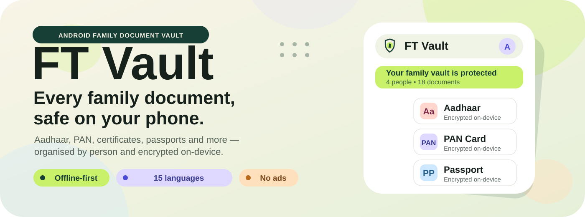
  </picture>
</p>

<p align="center">
  <a href="https://github.com/ft-sinan/My-vault-android/stargazers"></a>
  <a href="https://github.com/ft-sinan/My-vault-android/network/members"></a>
  <a href="LICENSE"></a>
</p>

<p align="center">
  A private, offline-first Android vault for Aadhaar, PAN, passports, driving licences,<br>
  certificates and the papers every Indian family needs close at hand.<br>
  <strong>No account. No ads. No document upload.</strong>
</p>

<p align="center">
  <picture>
    <source media="(prefers-color-scheme: dark)" srcset="assets/readme/chips-dark.svg">
    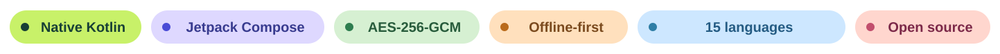
  </picture>
</p>

<p align="center">
  <a href="https://github.com/ft-sinan/My-vault-android/releases/latest"></a>
  <a href="https://github.com/ft-sinan/My-vault-android/releases"></a>
  <a href="#get-the-app"></a>
</p>

<p align="center">
  <a href="#screenshots"><strong>Screenshots</strong></a> ·
  <a href="#feature-atlas"><strong>Features</strong></a> ·
  <a href="#get-the-app"><strong>Download</strong></a> ·
  <a href="#security-and-privacy"><strong>Security</strong></a> ·
  <a href="#building"><strong>Build</strong></a> ·
  <a href="#acknowledgements"><strong>Credits</strong></a>
</p>

<details>
<summary><b>🔒 The short privacy answer</b></summary>

My Vault keeps your document files on your phone. There is no My Vault account, no advertising SDK and no background document sync.

The only network feature is the **manual update check** in Settings. It runs only after you tap it, talks to GitHub Releases, and never uploads document data. Backups are created only when you explicitly export a `.mvbackup` file.

</details>

<p align="center">
  <picture>
    <source media="(prefers-color-scheme: dark)" srcset="assets/readme/divider-dark.svg">
    
  </picture>
</p>

<a id="overview"></a>
##  Overview

My Vault is a native Android document vault made for families who keep more than one person's important papers on a single phone. Instead of dropping everything into one anonymous folder, it organises documents around **people first**: an owner profile, family-member profiles, and shared groups for the home, vehicle and other household papers.

Store Aadhaar cards, PAN cards, passports, driving licences, SSLC and degree certificates, birth certificates, RC books, insurance and property papers, and any other image or PDF that matters.

> A vault should feel calm when you open it — clear enough for everyday use, and serious about keeping private documents private.

At a glance:

- **Family-first organisation** with personal and shared document groups
- **Two ways in only:** Scan, or choose a File image/PDF
- **On-device OCR suggestions** for Aadhaar, PAN and Driving Licence details
- **AES-256-GCM encrypted files** protected by Android Keystore
- **English and Malayalam**, chosen on first open and changeable later
- **Portable `.mvbackup` files** for moving to another phone

<p align="center">
  <picture>
    <source media="(prefers-color-scheme: dark)" srcset="assets/readme/divider-dark.svg">
    
  </picture>
</p>

##  What makes My Vault different

Most document apps either behave like a generic cloud folder or make a family share one flat list. My Vault is built around how these papers are actually used at home: one phone may hold documents for parents, children, a vehicle and the house, and the right page is often needed quickly.

That is why the app keeps the model deliberately small:

- A personal document belongs to a **family member**.
- A household document belongs to **Family**, **Vehicle**, **Home / Property**, or **Other**.
- A document enters through **Scan** or **File** — there is no separate PDF/gallery maze.
- OCR can suggest details, but **you confirm everything before it is saved**.
- There are **no expiry dates or reminder features** to maintain.

The presentation is expressive and friendly; the storage model underneath stays plain, inspectable and offline-first.

<p align="center">
  <picture>
    <source media="(prefers-color-scheme: dark)" srcset="assets/readme/divider-dark.svg">
    
  </picture>
</p>

<a id="feature-atlas"></a>
##  Feature atlas

<table>
  <tr>
    <td width="50%" valign="top">
      <br>
      <strong>Family-first profiles</strong><br>
      The owner and each family member get an ID-card-style profile with their own documents, colour identity and actual profile photo when supplied. Profile cards can be shared as a clean image without relation or app branding.<br><br>
      <code>Owner + family</code> <code>Shared groups</code> <code>Profile cards</code>
    </td>
    <td width="50%" valign="top">
      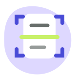<br>
      <strong>Scan or File — nothing else</strong><br>
      Use ML Kit multi-page scanning, or choose one image/PDF from the system file picker. On-device OCR suggests the type and number for Aadhaar, PAN and Driving Licence images before you confirm the details.<br><br>
      <code>Multi-page scan</code> <code>Image / PDF</code> <code>OCR suggestions</code>
    </td>
  </tr>
  <tr>
    <td width="50%" valign="top">
      <br>
      <strong>Private by design</strong><br>
      A PIN and optional biometric unlock guard the vault. Document pages and profile photos are encrypted with AES-256-GCM using Android Keystore, screenshots are blocked by default, and decrypted previews are wiped when the vault locks.<br><br>
      <code>PIN + biometrics</code> <code>Android Keystore</code> <code>Auto-lock</code>
    </td>
    <td width="50%" valign="top">
      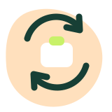<br>
      <strong>Backup that can move house</strong><br>
      Export the whole vault as one portable <code>.mvbackup</code>. Protect it with a PBKDF2/AES-256-GCM password, or explicitly choose no password after a warning. Restores verify checksums before anything is replaced.<br><br>
      <code>.mvbackup</code> <code>600k PBKDF2</code> <code>Verified restore</code>
    </td>
  </tr>
  <tr>
    <td width="50%" valign="top">
      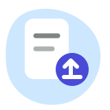<br>
      <strong>Find, view &amp; share fast</strong><br>
      Search and filter by person, group, category or favourites. View multi-page scans with zoom, render PDFs page by page, and share a document as a clearly named PDF or as images with a useful caption.<br><br>
      <code>Search</code> <code>Favourites</code> <code>PDF + image share</code>
    </td>
    <td width="50%" valign="top">
      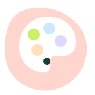<br>
      <strong>Personal, local and expressive</strong><br>
      Light theme and wallpaper colours are the friendly defaults, with System/Dark/OLED modes and curated palettes when you want them. Settings is split into focused pages, with a playful Creator Space.<br><br>
      <code>English + Malayalam</code> <code>Material You</code> <code>Creator Space</code>
    </td>
  </tr>
</table>

### And a few thoughtful details

- First open is **language → PIN → profile**; only the profile name is required.
- Long document titles expand inside the document card, without opening the document.
- Document numbers are masked until you choose to reveal or copy them.
- Shared profile-card images include available profile details **except relation**.
- Personal shared PDFs are named `Owner - Title.pdf`; group PDFs use the title alone.
- Android cloud/device backup is disabled for app data; portable backups are user-initiated.

<p align="center">
  <picture>
    <source media="(prefers-color-scheme: dark)" srcset="assets/readme/divider-dark.svg">
    
  </picture>
</p>

<a id="screenshots"></a>
##  Screenshots &amp; store previews

The gallery uses the fictional **Nair** family and masked sample values only. No real family documents, photos or ID numbers are used in this repository. Tap any preview to open the full-size file.

<table>
  <tr>
    <td width="25%" align="center"><a href="docs/store/screenshots/01-home.png">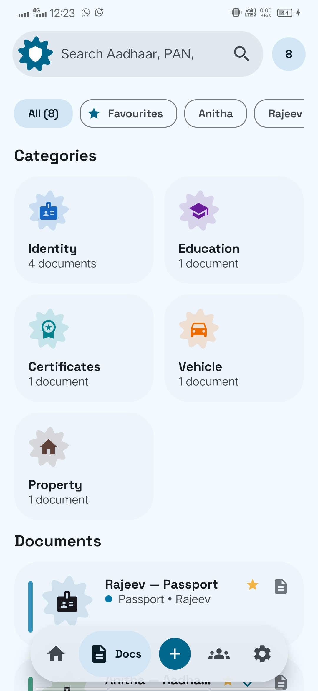</a><br><sub><strong>Home</strong><br>Owner, family and recent documents</sub></td>
    <td width="25%" align="center"><a href="docs/store/screenshots/02-documents.png">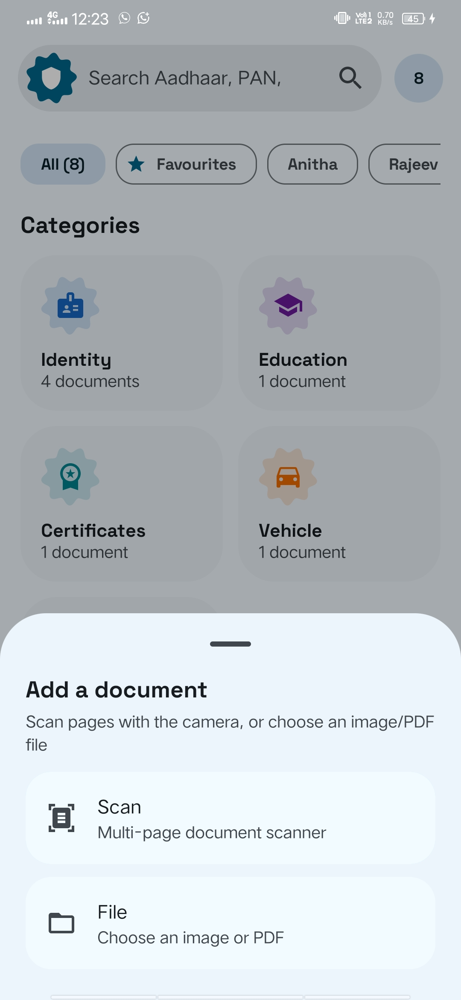</a><br><sub><strong>Documents</strong><br>Search, filters and masked numbers</sub></td>
    <td width="25%" align="center"><a href="docs/store/screenshots/03-family.png">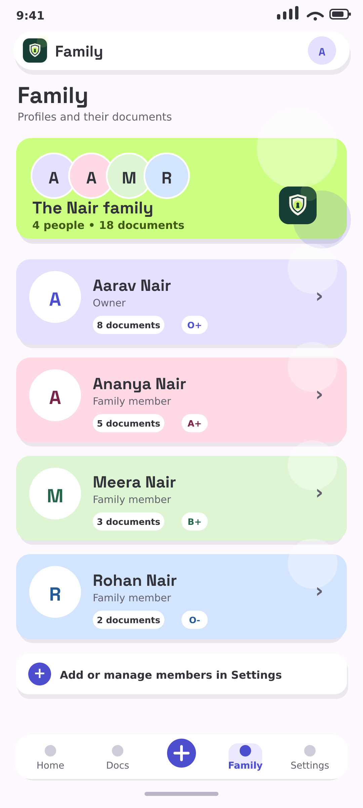</a><br><sub><strong>Family</strong><br>Profiles with their documents</sub></td>
    <td width="25%" align="center"><a href="docs/store/screenshots/04-backup.png">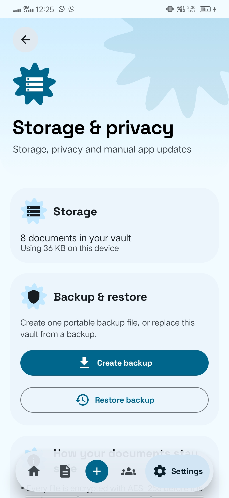</a><br><sub><strong>Backup &amp; restore</strong><br>Portable, verified vault files</sub></td>
  </tr>
</table>

<p align="center">
  Full-size store files, listing text and the fictional screenshot vault live in <a href="docs/store/"><code>docs/store/</code></a>.
</p>

<p align="center">
  <picture>
    <source media="(prefers-color-scheme: dark)" srcset="assets/readme/divider-dark.svg">
    
  </picture>
</p>

##  How it works

<p align="center">
  <picture>
    <source media="(prefers-color-scheme: dark)" srcset="assets/readme/workflow-dark.svg">
    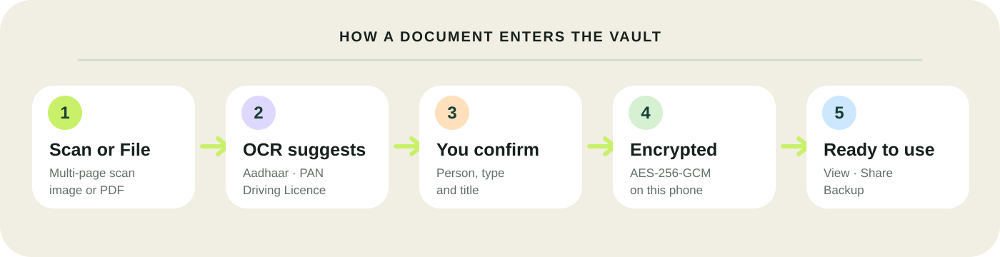
  </picture>
</p>

1. **Scan** a document with ML Kit, or use **File** to choose an image/PDF.
2. OCR may suggest an Aadhaar, PAN or Driving Licence number from an image.
3. Confirm the title, document type, category and person/group.
4. Every page is encrypted into app-private storage; Room keeps the searchable metadata.
5. Pages are decrypted only for viewing or sharing, and temporary copies are wiped on lock.

> OCR is an assistant, not an authority. Always review the suggested document type and number before saving.

<p align="center">
  <picture>
    <source media="(prefers-color-scheme: dark)" srcset="assets/readme/divider-dark.svg">
    
  </picture>
</p>

<a id="get-the-app"></a>
##  Get the app

### Install the signed release

1. Open the [**latest GitHub Release**](https://github.com/ft-sinan/My-vault-android/releases/latest).
2. Download `MyVault-vX.Y.Z.apk` — and its `.sha256` file if you want to verify the APK yourself.
3. Install it on an Android 8.0 or newer phone. Android may ask you to allow installs from your browser or file manager.
4. On first launch, choose **English** or **മലയാളം**, create a PIN, then add at least your name.

Later versions can be checked manually from **Settings → Storage & privacy → App updates → Check for updates**. When a release includes a checksum file, the downloaded APK is verified before Android's installer opens.

> **Remember your PIN.** A forgotten PIN is not recoverable by design if biometric unlock also becomes unavailable. Keep your original documents safe.

> Signed release APKs always use the same permanent signing key so they can update in place. CI debug APKs use a different signature and cannot update a signed release installation.

The ML Kit scanner requires Google Play services. If the scanner cannot open on a device, **File** still lets you add an image or PDF.

<p align="center">
  <picture>
    <source media="(prefers-color-scheme: dark)" srcset="assets/readme/divider-dark.svg">
    
  </picture>
</p>

<a id="security-and-privacy"></a>
##  Security &amp; privacy

<table>
  <tr>
    <th align="left">Area</th>
    <th align="left">How My Vault handles it</th>
  </tr>
  <tr>
    <td><strong>Vault access</strong></td>
    <td>4-digit PIN stored only as a salted, iterated SHA-256 hash; optional fingerprint/face unlock with PIN fallback.</td>
  </tr>
  <tr>
    <td><strong>Document files</strong></td>
    <td>Every page and profile photo is encrypted with AES-256-GCM. The key stays in Android Keystore.</td>
  </tr>
  <tr>
    <td><strong>On-screen privacy</strong></td>
    <td><code>FLAG_SECURE</code> is on by default, the vault auto-locks after one minute in the background, and decrypted preview/share files are wiped on lock.</td>
  </tr>
  <tr>
    <td><strong>Portable backups</strong></td>
    <td>Password backups use PBKDF2-HMAC-SHA256 at 600,000 iterations plus AES-256-GCM. Restore is staged and checksum-verified before replacement.</td>
  </tr>
  <tr>
    <td><strong>Network</strong></td>
    <td>Manual GitHub Releases update checks only. No account, ads, analytics upload or document sync.</td>
  </tr>
</table>

<details>
<summary><b>Current limits — stated plainly</b></summary>

- On-device encrypted files are bound to that phone's Android Keystore key. Use a portable `.mvbackup` to move phones, and test restore with sample documents before relying on it for a real migration.
- Room metadata such as titles, holder names, types and document numbers is not currently encrypted; document/profile-photo **files** are.
- A backup created without a password can be read by anyone who obtains the file.
- A forgotten backup password cannot be recovered.
- OCR currently focuses on Aadhaar, PAN and Driving Licence images; imported PDFs are preserved and viewed but not OCR-processed.
- The ML Kit scanner depends on Google Play services.

</details>

<p align="center">
  <picture>
    <source media="(prefers-color-scheme: dark)" srcset="assets/readme/divider-dark.svg">
    
  </picture>
</p>

<a id="project-structure"></a>
##  How the project is structured

My Vault is a single-activity Jetpack Compose app with a manual dependency container and MVVM-style screens.

<table>
  <tr>
    <td><strong>Area</strong></td>
    <td><strong>Responsibility</strong></td>
  </tr>
  <tr>
    <td><code>app/src/main/java/com/ftsinan/myvault/ui/</code></td>
    <td>Compose navigation shell, lock/setup, Home, Documents, scanner/file intake, multi-page viewer, profiles and Settings pages</td>
  </tr>
  <tr>
    <td><code>data/local/</code> + <code>data/model/</code></td>
    <td>Room v2 database, member/document/page models, DAOs and the non-destructive v1 → v2 migration</td>
  </tr>
  <tr>
    <td><code>data/repository/</code> + <code>data/storage/</code></td>
    <td>Document/member workflows and encrypted file import, decrypt-to-cache and cleanup</td>
  </tr>
  <tr>
    <td><code>data/security/</code></td>
    <td>Android Keystore AES-256-GCM, hashed PIN storage and process-local privacy controls</td>
  </tr>
  <tr>
    <td><code>data/backup/</code></td>
    <td>Portable <code>.mvbackup</code> format, optional password encryption, checksum validation and staged restore</td>
  </tr>
  <tr>
    <td><code>data/settings/</code> + <code>res/values(-ml)</code></td>
    <td>Appearance/language persistence and the English/Malayalam resources</td>
  </tr>
  <tr>
    <td><code>util/</code></td>
    <td>Formatting/masking, on-device OCR, profile-card generation and the manual GitHub update checker</td>
  </tr>
</table>

<p>
  <code>Kotlin 2.0</code>
  <code>Compose BOM 2024.12.01</code>
  <code>Material 3</code>
  <code>Room</code>
  <code>DataStore</code>
  <code>Biometric</code>
  <code>Coil</code>
  <code>ML Kit Scanner + OCR</code>
  <code>minSdk 26</code>
  <code>targetSdk 35</code>
</p>

<p align="center">
  <picture>
    <source media="(prefers-color-scheme: dark)" srcset="assets/readme/divider-dark.svg">
    
  </picture>
</p>

<a id="building"></a>
##  Building

Use Android Studio with **JDK 17**, open the repository, let Gradle sync, and run the `app` configuration on an API 26+ device or emulator.

```bash
./gradlew testDebugUnitTest
./gradlew assembleDebug
# APK: app/build/outputs/apk/debug/app-debug.apk
```

<details>
<summary><b>Maintainer release flow</b></summary>

1. Keep one permanent Android release keystore backed up safely; never commit it.
2. Configure `MYVAULT_RELEASE_KEYSTORE_BASE64`, `MYVAULT_RELEASE_STORE_PASSWORD`, `MYVAULT_RELEASE_KEY_ALIAS`, and `MYVAULT_RELEASE_KEY_PASSWORD` as GitHub repository secrets.
3. Bump `versionCode`/`versionName`, update `CHANGELOG.md`, and wait for debug CI to pass.
4. Push a matching version tag such as `v1.1.0`. The release workflow tests, signs, checksums and publishes the APK.

</details>

<p align="center">
  <picture>
    <source media="(prefers-color-scheme: dark)" srcset="assets/readme/divider-dark.svg">
    
  </picture>
</p>

##  Roadmap &amp; contributing

Ideas currently being explored:

- **Share to My Vault** from other apps
- **Trash & Undo Delete** for safer cleanup
- **Smarter Scan Autofill** beyond the current ID-number suggestions
- **App Icon Shortcuts** for Scan and favourite documents
- Encrypted Room metadata and wider OCR coverage

Bug reports and focused pull requests are welcome. Please use fictional sample documents in screenshots and test files — never upload a real Aadhaar, PAN, passport or other private document to an issue.

For UI work, start in `ui/screens/` and `ui/components/`. For storage or restore work, read `data/storage/`, `data/security/` and `data/backup/` together so encryption and cleanup behaviour stay aligned.

<p align="center">
  <picture>
    <source media="(prefers-color-scheme: dark)" srcset="assets/readme/divider-dark.svg">
    
  </picture>
</p>

<a id="acknowledgements"></a>
##  Acknowledgements

Special thanks to **[RookieZ / RookieEnough](https://github.com/RookieEnough)** and the **[Orion Store](https://github.com/RookieEnough/Orion-Store)** project. Orion's expressive capsule headers, pastel bento surfaces, floating dock, creator energy and shape-led README presentation helped inspire My Vault's look and feel. My Vault's artwork, copy and implementation are its own.

My Vault is an independent open-source project and is **not affiliated with or endorsed by Orion Store**.

Other credits:

- [Space Grotesk](https://fonts.google.com/specimen/Space+Grotesk), bundled for headings under the SIL Open Font License 1.1
- AndroidX, Jetpack Compose, Room, Navigation, DataStore and Biometric libraries
- Google ML Kit Document Scanner and Text Recognition
- Coil image loading

## Licence

My Vault is free software licensed under the **GNU General Public License v3.0**. See [`LICENSE`](LICENSE) for the full text.

<p align="center">
  <picture>
    <source media="(prefers-color-scheme: dark)" srcset="assets/readme/divider-dark.svg">
    
  </picture>
</p>

<p align="center">
  made with 🤍 by sinan
</p>
